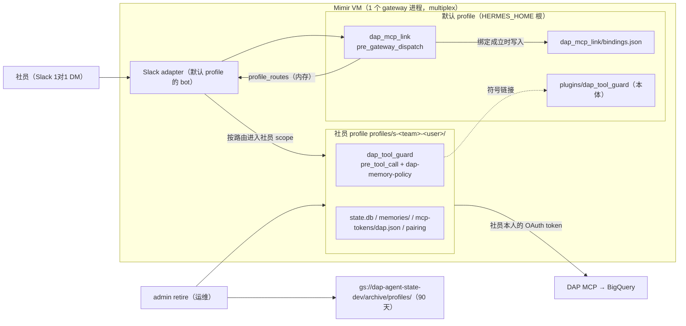
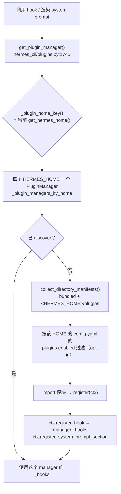
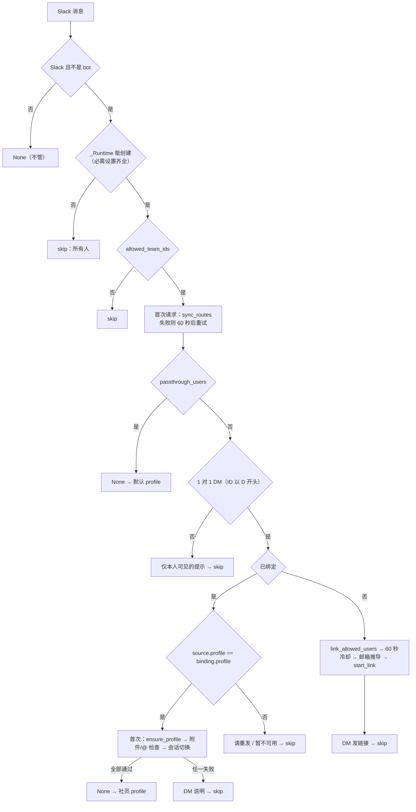
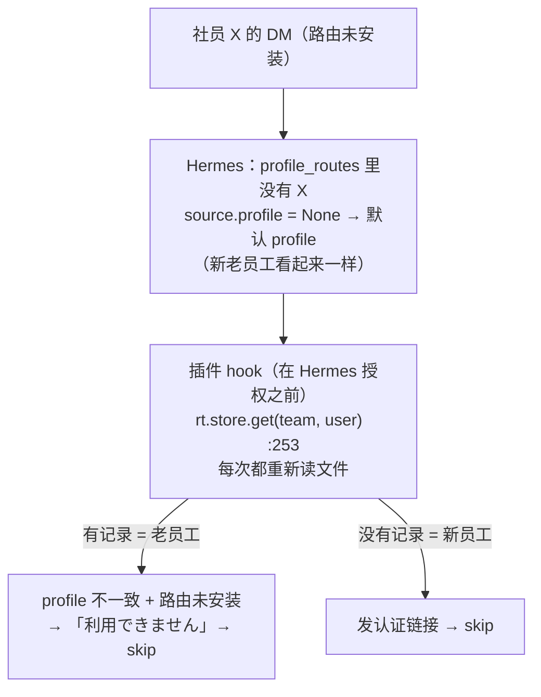
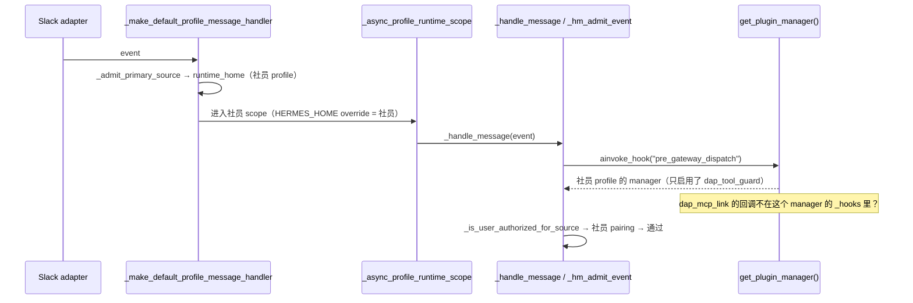

# Mimir 记忆隔离插件 学习笔记

返回[学习总览](../README.md)。

## 学习目标与范围

通过读代码理解 Mimir 记忆系统（ADR-0047 / 实装计划 0047 的 M 线）在 Phase 1 已实现的部分，并对照 Hermes 本体，弄清 plugin 是怎么生效的。只读代码，不修改代码。

| 项目 | 值 |
| --- | --- |
| Hermes | upstream `39faafb616`（读法：`git -C ~/projects/hermes show 39faafb616:<path>`。本仓库工作区不在这个 commit，行号以该 commit 为准） |
| 插件代码 | `data_analytics_platform_agent` 仓库，分支 `feature/dap-mcp-link`（PR #9，HEAD `45f2d378`），`plugins/dap_mcp_link/`、`plugins/dap_tool_guard/` |
| 设计文档 | 亲仓库 `documents/decisions/0047-mimir-per-user-memory-isolation.md`、`documents/implementation_plans/0047_mimir_per_user_memory.md` |
| 约束 | 不读 `.env`・token・密钥的值；不 SSH 到 VM；不读记忆和 `state.db` 的正文 |

证据的类型标在每条结论后面：**[代码]** = 读代码得出的事实；**[文档]** = Hermes 官方文档或项目文档的说法；**[推断]** = 由代码推出、尚未实际运行验证。

## 讲解顺序与进度

| 顺序 | 主题 | 状态 |
| --- | --- | --- |
| 1 | 整体：请求进来后的处理流程（`register` → `on_pre_gateway_dispatch`） | ✅ 已讲 |
| 2 | M1 绑定与 profile 的创建（`linking.py`、`store.py`） | 未开始 |
| 3 | M1 动态分配和放行（`access.py`） | 未开始 |
| 4 | M2 拒绝 `@` 引用和附件 | 未开始 |
| 5 | M4 会话切换 | 未开始 |
| 6 | M4 工具限制与记忆规则（`dap_tool_guard`） | 未开始 |
| 7 | M1 废止（`admin.py`） | 未开始 |
| 8 | 归档的生命周期（infra `storage.tf`） | 未开始 |
| 9 | 测试对照 | 未开始 |

## 术语

- **profile**：Hermes 的一套独立的 `HERMES_HOME` 目录（config、`state.db`、`memories/`、`skills/`、`mcp-tokens/`、`plugins/`）。默认 profile 在根目录，其他在 `profiles/<name>/`。
- **pairing**：Hermes 的"允许哪些用户使用"的记录（`PairingStore`），每个 profile 一份。
- **multiplex**（`gateway.multiplex_profiles`）：一个 gateway 进程同时服务多个 profile，按 `profile_routes` 把消息分给不同 profile。
- **scope**：Hermes 用 ContextVar `_HERMES_HOME_OVERRIDE` 表示"当前在哪个 profile 里执行"。`get_hermes_home()` 先看这个 ContextVar（`hermes_constants.py:111`）。
- **ContextVar**：Python 的上下文变量。每个 asyncio task / 线程上下文各自持有一份值，`copy_context()` 可以把当前值带到别的线程。

## 系统结构（Phase 1）

谁在什么时候做什么：

1. **每条 Slack 消息进来时**：默认 profile 上的 `dap_mcp_link` 通过 `pre_gateway_dispatch` 在模型之前判定（workspace → 1 对 1 DM → 是否已绑定 → 附件和 `@file:` → 会话切换）。不满足就 skip（丢弃）。
2. **未绑定的社员第一次来**：`LinkManager` 创建社员的 profile，用 DM 发 OAuth 链接。回调后用 `whoami` 校验，通过则先在**社员 profile 的 pairing** 记录批准，再写 `bindings.json`，最后改写 gateway 内存中的 `profile_routes`（M1）。
3. **Hermes 本体**：按 `profile_routes` 把社员的消息分到社员 profile，用社员 profile 的 pairing 判定授权，在社员的 `HERMES_HOME` 下执行这一轮。
4. **每次工具调用**：社员 profile 里的 `dap_tool_guard` 在 `pre_tool_call` 按白名单拦截；每个新会话的 system prompt 加上 `dap-memory-policy`（M4）。
5. **每轮后的后台 review**：由 Hermes 本体通过 ContextVar 把写入目标留在社员 profile（M3，无代码改动）。
6. **离职或异动**：`admin retire` 解绑 → 打包上传到 GCS → 确认后删除 VM 上的 profile。

## Hermes 的 plugin 是怎么生效的

### 加载

- **[代码]** PluginManager 按"解析后的 HERMES_HOME"缓存，每个 profile 一个（`hermes_cli/plugins.py:1633-1637`、`:1651` `_plugin_home_key`、`:1745` `get_plugin_manager`）。
- **[代码]** 扫描的目录是 bundled 和 `get_hermes_home() / "plugins"`（`hermes_cli/plugins_discovery.py:189` `collect_directory_manifests`），过滤用的是该 profile 的 `plugins.enabled`（`plugins_discovery.py:122`）。所以社员 profile 只会加载自己 `plugins/` 下、且在自己 `plugins.enabled` 里的 plugin。`dap_mcp_link` 因此在社员 profile 的 `plugins/` 里放了 `dap_tool_guard` 的符号链接，并只启用它（`linking.py` 的 `ensure_profile`）。
- **[代码]** 加载时调用模块的 `register(ctx)`（`hermes_cli/plugins_loader.py:413` `_load_plugin`）。`ctx.register_hook` 把回调放进**这个 manager** 的 `_hooks`（`plugins.py:974`）。
- **[代码]** `ctx.get_config(key)` 读取 `plugins.entries.<plugin_id>.settings.<key>`（`plugins.py:270`），读的是调用时 scope 的 config。
- **[代码]** 因为 manager 按 profile 分开，插件模块的全局变量也按 profile 分开。所以 `dap_mcp_link` 把进程内唯一的 `_Runtime` 放在 `sys` 上（`__init__.py:44-46`）。

### hook 的调用与失败处理

- **[代码]** `invoke_hook` / `ainvoke_hook` 都经由 `_delivery_manager()` → `get_plugin_manager()`，即**调用时 scope 的 manager**（`plugins.py:1891-1925`）。
- **[代码]** 回调抛出异常时，只有 `pre_tool_call` 会 fail-closed，转成 block（`hermes_cli/plugins_dispatch.py:49` `_HOOK_TIMEOUT_FAIL_CLOSED_HOOKS = {"pre_tool_call"}`）。其他 hook 只记日志（`:516`）。
- **[文档]** `pre_gateway_dispatch`："Exceptions in plugin callbacks are caught and logged; the gateway always falls through to normal dispatch on error."（`website/docs/user-guide/features/hooks.md:1229`）。这个 hook 不受 `hook_callback_timeout` 限制。
- **[代码]** 返回值：`{"action":"skip"}` → 丢弃；`rewrite` → 替换本文；`allow` / `None` → 正常处理（`gateway/run_inbound.py:111-146`）。

## 主题 1：`on_pre_gateway_dispatch`

### 防什么风险（ADR-0047）

| 风险 | 决定 |
| --- | --- |
| 没识别出社员的请求落到默认 profile（SA 权限 + 共享状态） | 决定 2 |
| thread 共享，或通过 `@file:` 展开读到别人的 profile | 决定 3 |
| DM 会话不结束，进不了保持期 | 决定 5 的过渡措施（M4） |

### 判定流程

| 步骤 | 位置（`plugins/dap_mcp_link/__init__.py`） |
| --- | --- |
| 注册 | `register` `:206`，`ctx.register_hook("pre_gateway_dispatch", ...)` `:330`；`_Runtime` 第一次调用时才创建 `:209-212`, `:153-174` |
| 非 Slack / bot | `:217-218` |
| 设置缺失 | `:219-222` |
| workspace | `:225-226` |
| 首次请求时 `sync_routes` | `:228-234` |
| passthrough | `:235-236` |
| 仅 1 对 1 DM | `:240-248` |
| 已绑定且已路由 | `:253-277` |
| 已绑定未路由 | `:278-283` |
| 未绑定 → 链接 | `:285-328` |

- **[代码]** `source.profile` 在 hook 之前由 `_canonicalize` 设置（`gateway/run_inbound.py:228-230` → `gateway/session_identity.py` 中的 `source.profile = routed or adapter_profile`）。
- **[代码]** 授权判定在 hook 之后（`run_inbound.py:270` 调用 hook，`:275` `_is_user_authorized_for_source`）。pairing store 按 `source.profile` 选（`gateway/authz_mixin.py:451` `_pairing_store_for`）。
- **[代码]** Slack adapter 的 `send` / `send_private_notice` 内部捕获异常、返回 `SendResult`，不会把异常抛到 hook 里。

### 失败时（fail-closed 的部分）

设置缺失时谁都不放行；routes 装不上时已绑定社员被拒；`ensure_profile` 失败、parser 读不进来、会话切换失败时都 skip。最根本的保险是**pairing 只写在社员 profile**：插件不工作、路由不生效时，社员按默认 profile 判定，然后被拒。

### 测试（`tests/test_dispatch.py`）

fixture（`:85-111`）把 `_Runtime` 注入 `sys`，**直接调用 hook 函数**，不经过 Hermes 的 gateway。

- workspace / passthrough：`test_other_workspace_is_refused_silently`、`test_passthrough_user_is_not_gated`
- 仅 DM：`test_one_to_one_dm_detection`、`test_channel_message_gets_private_notice_once_per_thread`、`test_mpim_is_refused`、`test_bound_user_in_channel_is_still_refused`
- 路由与 profile：`test_bound_and_routed_dm_passes_after_profile_is_ensured_once`、`test_routed_dm_is_refused_when_profile_cannot_be_ensured`、`test_bound_but_not_routed_dm_is_asked_to_resend`、`test_bound_user_is_refused_while_routes_cannot_be_installed`、`test_routes_are_installed_on_first_message_even_from_passthrough_user`
- 链接：`test_link_is_sent_only_to_allowed_users_during_verification`、`test_phase0_sends_link_without_reading_slack_email`
- 没有测试的路径：设置缺失、链接冷却、`start_link` 失败、邮箱推不出 analytics 账号

### 问答：插件状态与 Hermes 状态的分工

#### Q1. `rt.gateway_ref = weakref.ref(gateway)`（`__init__.py:227`）有必要吗？

**我的理解**：gateway 一直是同一个对象，每条消息都重新创建弱引用没有必要。

**结论**：对了一半。gateway 不变时，每次都赋值确实是多余的，但这一行不能删。

- **[代码]** 插件只有在这里才能拿到 gateway。`register(ctx)` 不传 gateway；`_Runtime` 创建时也没有 gateway，只放了一个占位 `lambda: None`（`:135`）。hook 的参数里才有 gateway。
- **[代码]** `sync_routes`（`:140-150`）除了在 hook 里调用，还作为 `on_bound`（`:138`）在 OAuth 的 worker 线程里调用（绑定成立时）。那里拿不到 gateway，只能用 `rt.gateway_ref()`。发起绑定的那条消息一定先经过 `:227`，所以 `on_bound` 被调用时引用已经设好。
- **[运行]** CPython 对没有 callback 的 `weakref.ref(obj)` 会复用同一个对象（本地确认 `weakref.ref(g) is weakref.ref(g)` → `True`）。所以每条消息的开销只是一次属性赋值。
- **[代码]** 用弱引用而不是直接保存 gateway：`_Runtime` 挂在 `sys` 上，生命周期是整个进程。强引用会让旧 runner 无法回收，`sync_routes` 也可能写进旧 runner；用弱引用，runner 被回收后 `sync_routes` 会直接 return（`:142-144`）。
- **[代码]** 生产环境每个进程只创建一次 `GatewayRunner`（Hermes `gateway/run.py:5864`）。evals 和测试会在同一进程中创建多个；`hermes_cli/plugins.py:1696` 的注释也考虑到了 runner 被替换。

**追问：写成 `if rt.gateway_ref is None or rt.gateway_ref() is not gateway:`，或者在初始化 runtime 时只设置一次，可以吗？**

- 前者可以，但 `rt.gateway_ref is None` 永远不成立（初始值是 `lambda: None`，它本身不是 `None`）。写 `if rt.gateway_ref() is not gateway:` 就够了，行为和现在一样。
- 后者也只能在 hook 里做：`register(ctx)` 拿不到 gateway，`ctx` 里也没有取得 runner 的公开 API（plugin manager 里的 `_gateway_message_injector` 的 owner 是私有属性）。实际做法是第一次调用 `get_rt()` 时把 gateway 传进去（这次调用也发生在 hook 里，`:219`）。`_Runtime` 是进程单例，后来传进来的 gateway 会被忽略。测试 fixture（`tests/test_dispatch.py:99`）也需要跟着改。
- **更正（我在讲解中一度说错）**：我说过"现在的写法在 runner 被替换时会自动指向新的 runner"。`gateway_ref` 确实会指向新的 runner，但 `routes_installed` 也在进程单例上，已经是 `True`，所以 `:228` 不会再执行，新的 runner 不会重新安装路由。两种写法都不真正支持在同一进程里替换 runner，只是失败的样子不同（都是 fail-closed）：

| | runner 被替换后 | 结果 |
| --- | --- | --- |
| 现在的写法 | 引用指向新 runner，但路由不会重新安装 | 已绑定社员被要求重发（`:278-280`） |
| 只设置一次 | 引用指向已回收的旧 runner，`sync_routes` 直接 return | 已绑定社员收到"暂时无法使用"（`:282`） |

生产环境只有一个 runner，所以不需要修改。真要支持替换 runner，需要记录"路由装进了哪个 runner"，只改这一行不够。

#### Q2. 重启后恢复路由的那段代码（`:228-234`）如果没有，老用户会怎样？

**我的理解**：这段是在 agent 或 gateway 重启时恢复绑定关系和路由。不知道没有它时，老用户是会新建 profile、被拒绝，还是仍能访问原来的 profile。

**结论**：被拒绝。老用户会收到「現在 Mimir を利用できません」的 DM。不会新建 profile，也进不了原来的 profile，不会落到默认 profile。原来的 profile 在磁盘上完好无损。另外要修正一点：这段代码恢复的**只有路由**，绑定关系本来就存在文件里。

| 状态 | 存在哪里 | 重启后 |
| --- | --- | --- |
| 绑定记录（Slack user → profile） | `<根>/dap_mcp_link/bindings.json` | 还在 |
| pairing 的批准 | 社员 profile 的 pairing 文件（`access.py:51-61`） | 还在 |
| 社员 profile（`state.db`・`memories/`・`mcp-tokens/`） | `profiles/s-<team>-<user>/` | 还在 |
| 路由 | 只在内存：`gateway.config.profile_routes`（`access.py:34-48`） | **丢失** |

- **[代码]** 插件不往 `config.yaml` 写路由。Hermes 启动时 `config.yaml` 里没有社员的路由，所以每次启动后都要从 `bindings.json` 重建。
- **[代码]** 没有路由时：Hermes 设 `source.profile = None` → 默认 profile 的 scope → `dap_mcp_link` 的 hook 正常执行 → `rt.store.get` 找到绑定（`:253`）→ `source.profile` 和绑定的 profile 不一致（`:255`）→ 路由未安装（`:278`）→ 发 DM 然后 skip（`:282-283`）。
- **[代码]** 不会新建 profile：创建 profile 只发生在未绑定的路径（`:285` 之后，`start_link` → `ensure_profile`）。
- **[代码]** 就算 hook 没有执行（第二道防线）：`source.profile` 是 `None`，`_pairing_store_for` 选默认 profile 的 pairing（Hermes `gateway/authz_mixin.py:451`），里面没有这个社员的批准，判定为未授权。
- **[推断]** 这个场景中消息停留在默认 profile 的 scope，所以不受疑点 1 的影响。

**追问：那是不是没有这一步，谁都用不了 Mimir，和新老用户无关？**

不是。受影响的只有已绑定的老社员：

| 用户 | 没有这一步时 |
| --- | --- |
| passthrough（基盤チーム） | 照常使用。`:235-236` 不经过路由 |
| 未绑定的新社员 | 可以收到链接、完成绑定，然后正常使用。绑定成功时 `on_bound` → `sync_routes` 会安装路由 |
| 已绑定的老社员 | 被拒绝，直到下一个新社员完成绑定 |

- **[代码]** `sync_routes` 每次都把 `bindings.json` 里**所有人**的路由一起装进去（`access.py:44`）。只要有一个新社员绑定成功，老社员也会同时恢复。`:228-234` 的作用是把恢复时机固定在重启后的第一条消息。第一条消息由谁发都可以，包括 passthrough 用户，因为 `:228` 在 `:235` 之前。
- **[代码]** 恢复失败时 60 秒内不再重试（`_ROUTE_RETRY_S`），这期间老社员同样被拒（fail-closed）。
- 测试：`test_routes_are_installed_on_first_message_even_from_passthrough_user`、`test_bound_user_is_refused_while_routes_cannot_be_installed`、`test_bound_but_not_routed_dm_is_asked_to_resend`。

#### Q3. 路由没有安装时，gateway 怎么知道是新用户还是老用户？

**结论**：Hermes 不知道，区分新老用户的是插件，依据是插件自己的绑定记录，与路由无关。

| | 绑定记录 | 路由 |
| --- | --- | --- |
| 属于 | 插件 | Hermes |
| 存在哪里 | `bindings.json`（文件） | 内存 |
| 回答的问题 | 这个人是否已绑定？绑定的是哪个 profile？ | 这条消息在哪个 profile 里执行？ |

- **[代码]** 路由是根据绑定记录生成的（`access.py:25-31`），绑定记录才是依据。
- **[代码]** `BindingStore.get` 每次都重新读文件，不缓存（`store.py:36-40`, `:54-57`）。OAuth 线程写入的绑定，下一条消息马上就能看到。
- 这样分工的结果是 Hermes 不需要知道"绑定"这个概念：没有路由的社员一律按默认 profile 判定授权，然后被拒。

## 疑点与待验证

### 疑点 1：已路由到社员 profile 的消息，`dap_mcp_link` 的 hook 可能不会被调用（[推断]，需实测）

项目文档（agent 仓库 README「既知の制約」、亲仓库计划 0046 第 205 行）的说法是："`pre_gateway_dispatch` 在进入任何 profile 的 scope 之前被调用，所以默认 profile 上的 `dap_mcp_link` 也作用于已路由的社员"。但 `39faafb616` 的代码顺序如下：

- **[代码]** `gateway/run_adapters.py:1631-1633`：先 `_admit_primary_source` 得到 runtime_home，再 `async with _async_profile_runtime_scope(profile_home)`，然后才 `await self._handle_message(event)`。
- **[代码]** `gateway/run.py` 的 `_profile_runtime_scope` 调用 `set_hermes_home_override(profile_home)`。
- **[代码]** hook 发给 `get_plugin_manager()`，即当前 HERMES_HOME 的 manager（见上节）。
- **[代码]** 社员 profile 的 `plugins.enabled` 只有 `dap_tool_guard`。

如果成立：已路由社员的"仅 DM"、附件和 `@file:` 拒绝、会话切换、`ensure_profile` 都不会执行，而社员 pairing 本身有效，请求会到达模型。这种情况就不是 fail-closed 了。现有测试直接调用 hook，覆盖不到。

验证方法（未执行）：在计划 0046「検証の進め方」第 3 步，让已绑定的测试社员在 DM 里发 `@file:` 和附件，再在频道里发一条，看 gateway 日志里有没有 `pre_gateway_dispatch skip: reason=dap_mcp_link: ...`。

### 疑点 2：hook 内未捕获的异常会被当作放行（[代码] + [文档]）

`pre_gateway_dispatch` 的回调抛出异常时，Hermes 正常处理这条消息（见"hook 的调用与失败处理"）。插件内没有用 try 包住的地方：`rt.store.get`（`bindings.json` 损坏时抛 `JSONDecodeError`）、`_delivery_adapter_for` 返回 `None` 时、`parse_context_references(text)` 的调用本身（只有 import 包了 try，`__init__.py:95-102`）。对已路由的社员，这几处一旦抛异常，后续检查会全部跳过。

### 待看 1：路由只匹配 `user_id`，不看 `team_id`（[代码]，主题 3 再看）

`route_entries` 生成的路由只有 `platform` 和 `user_id`，`team_id` 只出现在路由的 `name` 里（`access.py:25-31`）。workspace 的限制由 hook 的 `allowed_team_ids` 负责。如果 hook 没有执行（疑点 1、2），这一层还剩下哪些保护，在主题 3 确认。
